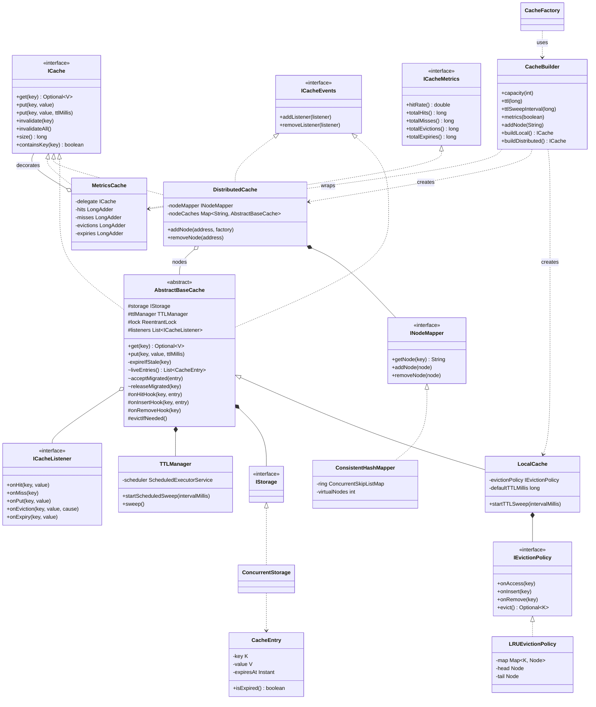

# Distributed Cache: SOLID + Design Patterns

A thread-safe, in-memory distributed cache written in **pure Java with zero external dependencies**. It shows how a cache like Redis handles its three core problems (limited memory, stale data, and spreading data across machines), using SOLID principles and classic design patterns.

**Highlights**

- **O(1) LRU eviction** with a hash map + doubly linked list
- **TTL expiry**, both lazy (on read) and with a background sweep thread
- **Consistent hashing** with 150 virtual nodes per node; adding a node moves only ~1/N of the keys
- **Thread-safe**: one lock per cache, so in distributed mode each node is locked independently (lock striping)
- **Rebalancing**: keys move to their new owner when nodes join or leave, with no stale reads
- **Lock-free metrics** (`LongAdder`) for hits, misses, evictions and expiries
- **~10M ops/sec** single-threaded in local benchmarks
- **10 tests** with a dependency-free runner, including an 8-thread stress test

---

## The three problems a cache solves

| Problem | Solution | Where |
| --- | --- | --- |
| Memory is limited. What do you throw out when full? | **LRU eviction**: remove the least recently used key | `eviction/LRUEvictionPolicy.java` |
| Data goes stale. How do entries disappear over time? | **TTL**: each entry can carry an expiry time | `ttl/TTLManager.java`, `storage/CacheEntry.java` |
| One machine isn't enough. How do you spread keys? | **Consistent hashing** across nodes | `distribution/ConsistentHashMapper.java` |

---

## How it works

### `put` and `get`, step by step

**`cache.put("d", "Date")`** on a full cache (capacity 3, holding a, b, c):

```
MetricsCache.put            → passes through (Decorator)
AbstractBaseCache.put       → takes the cache lock
  ├─ storage.put            → ConcurrentHashMap now holds 4 entries
  ├─ onInsertHook           → LRU moves "d" to the FRONT of its list
  └─ evictIfNeeded          → LRU sees 4 > 3 and evicts the BACK of the list
                               → listeners notified: EvictionCause.CAPACITY
```

**`cache.get("a")`**:

```
MetricsCache.get            → calls the delegate, then counts a hit or miss
AbstractBaseCache.get       → takes the cache lock
  ├─ expired?               → remove it (lazy expiry) and return a MISS
  ├─ missing?               → return a MISS
  └─ found                  → LRU moves "a" to the FRONT, return the value
```

### LRU in O(1)

```
FRONT (most recent)  [d] ⇄ [a] ⇄ [c]  BACK (least recent → evicted next)
```

- The **hash map** finds a key's list node in O(1).
- The **doubly linked list** keeps usage order. Moving or removing a node only changes a few pointers, which is O(1).
- **Sentinel `head`/`tail` nodes** remove all null checks at the ends.

Each structure alone is O(n) for something: a map can't find the oldest key without scanning, and a list can't find a given key without walking it.

### TTL: lazy expiry plus a background sweep

- **Lazy expiry:** `get` checks whether the entry has expired and removes it if so. This guarantees an expired value is never returned.
- **Background sweep** (`.ttlSweepInterval(ms)`): a daemon thread periodically removes expired entries that **nobody reads**, so they don't sit in memory forever.

Both paths go through a single method that takes the cache lock and removes the key from storage **and** from the eviction policy.

### Consistent hashing

- Each node is placed at **150 points** on a hash ring (MD5 of `"node1#0"`, `"node1#1"`, …), stored in a `ConcurrentSkipListMap`.
- A key belongs to the first node clockwise from its hash: `ring.ceilingEntry(hash)`, wrapping to `firstEntry()`.
- **Why a ring instead of `hash % N`?** With modulo, changing N remaps almost every key. With the ring, adding a node moves only about 1/N of them (measured: going from 1 to 2 nodes moved 488 of 1,000 keys).
- **Why virtual nodes?** With one point per node, the gaps on the ring are uneven and one node can own most of the keys. 150 points per node even out the load, and a departing node's keys spread across *all* remaining nodes instead of landing on one neighbour.

### Thread safety

- Each cache instance has **one `ReentrantLock`** guarding `get`, `put`, `invalidate` and expiry.
- `get` needs the lock too, because it **mutates** state: it moves the key to the front of the LRU list. A read-write lock wouldn't help.
- In distributed mode **each node is its own cache with its own lock**, so threads working on different nodes never block each other. This is **lock striping**, the same idea `ConcurrentHashMap` uses.
- Listener lists are `CopyOnWriteArrayList`; metrics use `LongAdder` (lock-free, low contention).

### Rebalancing when nodes join or leave

- **`addNode`** registers the new node, switches routing to it, then **moves** every key it now owns from the other nodes.
- **`removeNode`** moves the departing node's live entries to their new owners.
- Moved entries **keep their original expiry time** and **never overwrite a newer write** already on the target node.

Without rebalancing, a key's old copy stays behind on its previous node. If the new node later leaves, the key maps back and the **old value reappears**: a stale read, not just a miss.

---

## Design patterns

| Pattern | Where | Why |
| --- | --- | --- |
| **Builder** | `CacheBuilder` | Fluent construction of any cache variant |
| **Factory Method** | `CacheFactory` | Ready-made presets (`lruLocal`, `distributed`, `unbounded`) |
| **Decorator** | `MetricsCache` | Adds metrics to *any* `ICache` without changing it; toggled with `.metrics(true)` |
| **Template Method** | `AbstractBaseCache` | Fixes the get/put algorithm and locking; subclasses fill in hooks |
| **Strategy** | `IEvictionPolicy` | Swap LRU for another eviction algorithm |
| **Observer** | `ICacheListener` / `ICacheEvents` | Hit, miss, put, eviction and expiry events; `MetricsCache` uses them to count evictions |

SOLID in practice: each class has one job (storage, eviction, expiry, routing, metrics); new behaviour is added by wrapping or plugging in (Open/Closed); everything depends on interfaces such as `ICache`, `IStorage` and `IEvictionPolicy` (Dependency Inversion).

---

## Quick start

```java
// Local LRU cache: 1,000 entries, 60s TTL, background sweep, metrics
ICache<String, String> cache = CacheBuilder.<String, String>newBuilder()
        .capacity(1000)
        .ttl(60_000)
        .ttlSweepInterval(60_000)
        .metrics(true)
        .buildLocal();

cache.put("user:1", "Utkarsh");
cache.get("user:1");                  // Optional[Utkarsh]

ICacheMetrics metrics = (ICacheMetrics) cache;
metrics.hitRate();                    // 1.0

// Distributed across 3 nodes (each node holds up to 500 entries)
ICache<String, String> dist = CacheBuilder.<String, String>newBuilder()
        .capacity(500)
        .addNode("node1:6379")
        .addNode("node2:6379")
        .addNode("node3:6379")
        .metrics(true)
        .buildDistributed();

// One-line presets
ICache<String, String> lru   = CacheFactory.lruLocal(1_000, 60_000);
ICache<String, String> dist2 = CacheFactory.distributed(500, "node1", "node2");
```

### Builder options

| Method | Default | Purpose |
| --- | --- | --- |
| `capacity(int)` | 1000 | Max entries (per node in distributed mode) |
| `ttl(long ms)` | 0 (none) | Default TTL for `put(key, value)` |
| `ttlSweepInterval(long ms)` | off | Start the background expiry sweep |
| `metrics(boolean)` | false | Wrap in `MetricsCache` |
| `evictionPolicy(policy)` | LRU | Custom policy (local mode only; distributed mode uses LRU per node) |
| `addNode(String)` | none | Nodes for `buildDistributed()` |

---

## Running

```bash
# Demo
javac -d out $(find src -name '*.java') && java -cp out Main

# Tests
javac -d out $(find src test -name '*.java') && java -cp out CacheTests
```

Requires Java 17+ (tested on Java 21).

### Tests

`test/CacheTests.java` is a small dependency-free test runner (no JUnit, matching the zero-dependency design):

| Test | Checks |
| --- | --- |
| LRU evicts the least recently used key | Basic LRU order |
| Concurrent get/put never exceeds capacity or throws | 8 threads × 200K ops; size stays ≤ capacity |
| Metrics count capacity evictions and expiries | Evictions/expiries counted; `invalidate` excluded |
| Distributed metrics count evictions across nodes | 300 puts over 3 × 10 capacity → 270 evictions |
| Adding a node loses no keys | All 3,000 keys readable after rebalancing |
| Add then remove a node never returns stale values | No old values resurface |
| Migrated entries keep their original TTL | Moving a key doesn't reset its expiry |
| Background sweep removes expired keys nobody reads | 500 unread expired keys cleaned up |
| Distributed build rejects a shared eviction policy | Prevents one LRU list being shared by all nodes |
| Expired keys are removed from the eviction policy | No "ghost" keys after lazy or swept expiry |

---

## Performance

Measured locally (Java 21, 10-core laptop), 75% reads / 25% writes over 200K random keys:

| Setup | Throughput |
| --- | --- |
| Local cache, 1 thread | **~10.1M ops/sec** |
| Local cache, 8 threads | ~5.7M ops/sec |
| Distributed (8 nodes), 8 threads | ~3.7M ops/sec |

The distributed number is lower because every operation computes an **MD5 hash** to pick a node, which is expensive in Java. A cheaper hash such as MurmurHash, or a reused `MessageDigest`, is the obvious next optimisation.

> These are single-machine microbenchmarks, a baseline rather than a production figure.

---

## Reliability fixes

Probing the original implementation found five bugs, now fixed and covered by tests:

| Problem | Before | Fix |
| --- | --- | --- |
| Not thread-safe | 8 threads: capacity-1,000 cache held **4,999** entries and threw | Per-cache `ReentrantLock`; sweep thread uses the same lock |
| Eviction/expiry metrics | Always **0** | `MetricsCache` subscribes to cache events |
| Stale reads after node changes | **488 / 1,000** keys returned old values | Rebalancing on `addNode` / `removeNode` |
| Background sweep | Never started | `CacheBuilder.ttlSweepInterval(ms)` |
| Ghost keys | Expired keys stayed in the LRU list | Expiry also removes the key from the eviction policy |

---

## Package structure

```
src/
├── Main.java                     Demo of local, TTL, distributed and preset caches
├── api/
│   ├── ICache.java               Core cache interface
│   ├── ICacheMetrics.java        Metrics interface
│   └── ICacheEvents.java         Listener registration
├── service/
│   ├── AbstractBaseCache.java    Template Method base: locking, get/put flow, expiry, rebalancing hooks
│   ├── LocalCache.java           Storage + eviction policy + TTL on one node
│   ├── DistributedCache.java     Routes keys to nodes; rebalances on add/remove
│   └── MetricsCache.java         Decorator: lock-free metrics
├── storage/
│   ├── IStorage.java             Storage abstraction
│   ├── ConcurrentStorage.java    ConcurrentHashMap implementation
│   └── CacheEntry.java           Immutable value + expiry metadata
├── eviction/
│   ├── IEvictionPolicy.java      Eviction strategy interface
│   └── LRUEvictionPolicy.java    HashMap + doubly linked list
├── distribution/
│   ├── INodeMapper.java          Key → node routing interface
│   └── ConsistentHashMapper.java MD5 hash ring with virtual nodes
├── ttl/
│   └── TTLManager.java           Background sweep that finds expired entries
├── events/
│   ├── ICacheListener.java       Observer interface
│   ├── EvictionCause.java        CAPACITY / EXPLICIT / EXPIRED
│   ├── NoOpCacheListener.java    No-op base class
│   └── LoggingCacheListener.java java.util.logging implementation
└── factory/
    ├── CacheBuilder.java         Fluent builder
    ├── CacheFactory.java         Static presets
    └── CacheConfig.java          Config value object (not yet wired into the builder)
test/
└── CacheTests.java               Dependency-free test runner (10 tests)
```

---

## Class diagram



---

## Future improvements

- **Faster hashing** for routing (MurmurHash or a per-thread `MessageDigest`) to lift distributed throughput
- **Replication**: `INodeMapper.getNodes(key, replicationFactor)` already returns the next N distinct nodes; writing to them would let a node fail without losing data
- **More eviction policies** (LFU, FIFO) behind `IEvictionPolicy`
- **Real network nodes**: today every "node" is an in-process cache; a TCP or gRPC layer would make it truly distributed
- **Wire `CacheConfig`** into the builder and add `close()` to stop sweep threads explicitly
